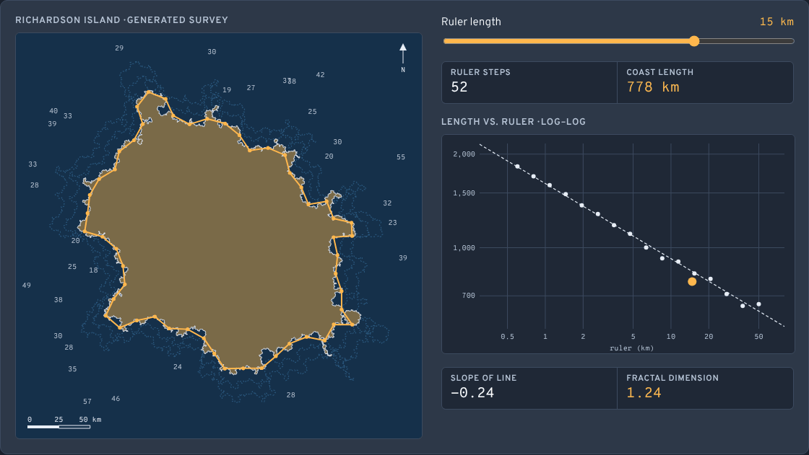
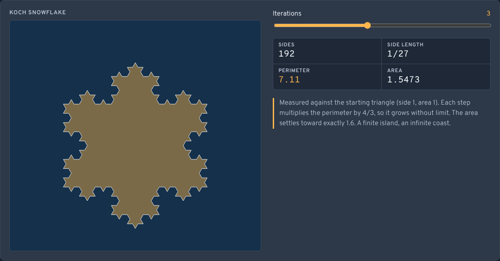
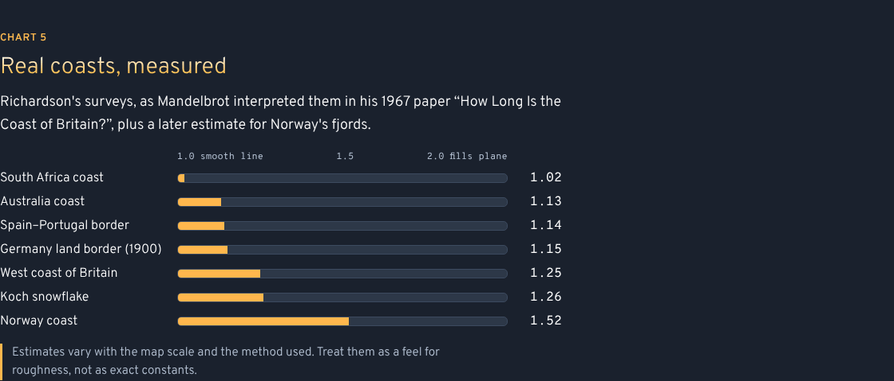
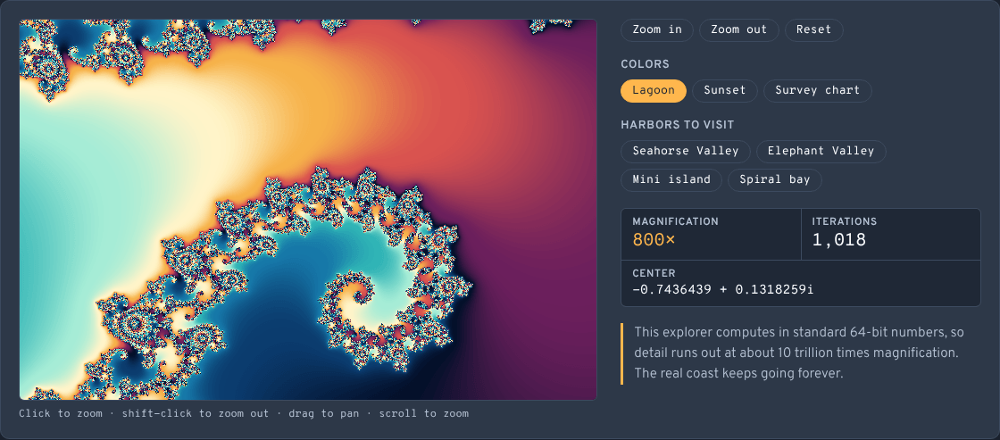

# Infinite-Coastlines

How long is a coastline? It depends on the length of your ruler, and the closer you look, the longer it gets. Six interactive charts on the coastline paradox and fractal dimension, from a ruler survey of an island to the edge of the Mandelbrot set. No sign-up and no libraries.

- [Measure a coastline](https://evoluteur.github.io/infinite-coastlines/) 

## What it does

1. **Two countries, one border, two lengths**: walk a ruler (1 to 60 km) around a generated island and watch the measured length grow as the ruler shrinks. A log–log plot of length vs. ruler gives the fractal dimension from its slope (D = 1 − slope).

   

2. **Rougher coasts grow faster**: set the island's roughness (dimension 1.05 to 1.5), generate new islands, and check that the survey recovers it.
3. **A coastline built from one rule**: step through the Koch snowflake. The perimeter grows by 4/3 at each step while the area settles at 8/5 of the starting triangle.

   

4. **What "1.26 dimensions" means**: the scaling rule N = s^D for a line, a square and a Koch curve.
5. **Real coasts, measured**: Richardson's data as interpreted by Mandelbrot (1967), plus Norway.

   

6. **The coast that never ends**: a zoomable Mandelbrot set. Click to zoom in, shift-click to zoom out, drag to pan, scroll to zoom, or jump to a preset. Three palettes: Lagoon, Sunset and Survey chart. It uses 64-bit floats, so zoom is capped near 10¹³×.

   

## How it is built

Plain HTML, CSS and JavaScript, with no dependencies and no build step. Just open `index.html`. Everything is drawn on canvases.

- The app logic is in [js/coastlines.js](https://github.com/evoluteur/infinite-coastlines/blob/main/js/coastlines.js), its styles in `css/coastlines.css`.
- Three color themes (dark, light and blue) are shared with my other projects through [OMG-Themes](https://github.com/evoluteur/omg-themes). Run `npm run sync:themes` to refresh `css/core.css`, `css/densities.css`, `css/themes/*` and `js/omg.js` from it. Project tweaks go in `css/overrides.css`. The canvases read their colors from the theme.
- Your theme is kept in the browser's local storage.

### The island

The island starts as a lumpy 12-sided outline. Each segment's midpoint is pushed sideways by a random amount proportional to the segment's length, repeated 11 times (24,576 points). Each level doubles the pieces and scales them by r = √(1 + 4g²) / 2, so the curve is self-similar with dimension log 2 / log(1/r).

The length is measured with the divider (Richardson) method: from the current point, step to the next point on the coast exactly one ruler length away.

## References

- B. Mandelbrot, "How Long Is the Coast of Britain? Statistical Self-Similarity and Fractional Dimension", *Science* 156 (1967).
- L. F. Richardson, "The problem of contiguity", *General Systems Yearbook* 6 (1961).
- J. Feder, *Fractals* (1988).
- M. Shishikura, "The Hausdorff dimension of the boundary of the Mandelbrot set and Julia sets", *Annals of Mathematics* 147 (1998).

Infinite-Coastlines is open source at [GitHub](https://github.com/evoluteur/infinite-coastlines) with MIT license.

Had fun browsing the app? [Buy me a coffee by becoming a sponsor](https://github.com/sponsors/evoluteur).

You may also be interested in my other projects [Sunflower Golden Angle](https://github.com/evoluteur/sunflower-golden-angle), [Mandelbrot and Julia](https://github.com/evoluteur/mandelbrot-julia) and [Snowflake Grower](https://github.com/evoluteur/snowflake-grower). See them all on [Generative Art](https://evoluteur.github.io/generative-art.html).

Copyright (c) 2026 [Olivier Giulieri](https://evoluteur.github.io/).
